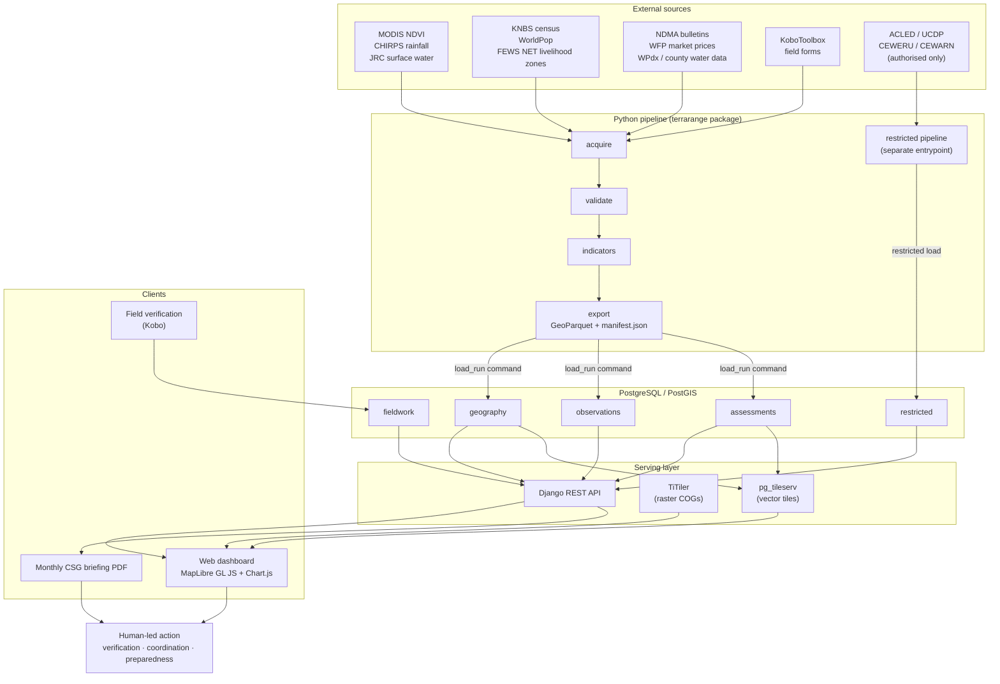
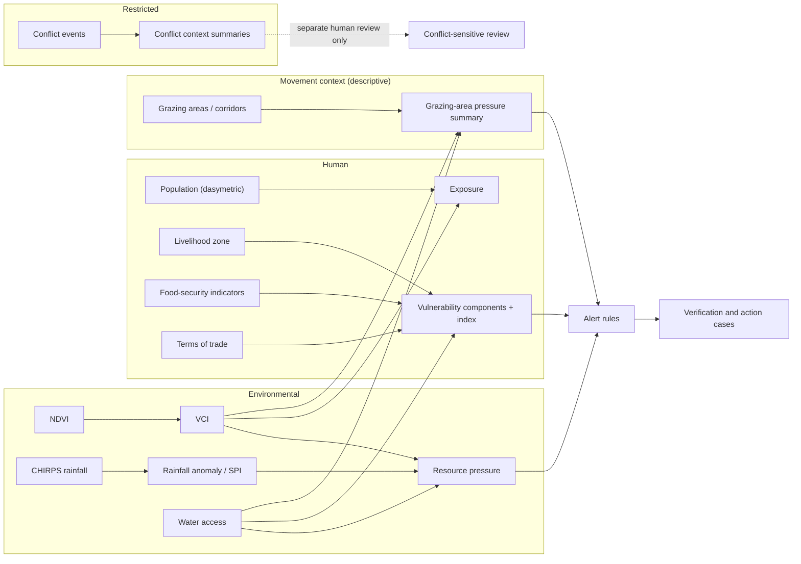
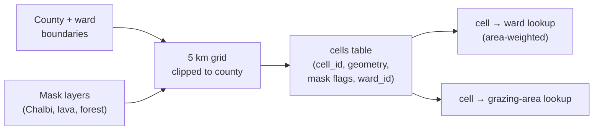
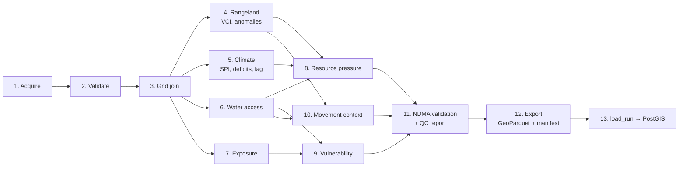
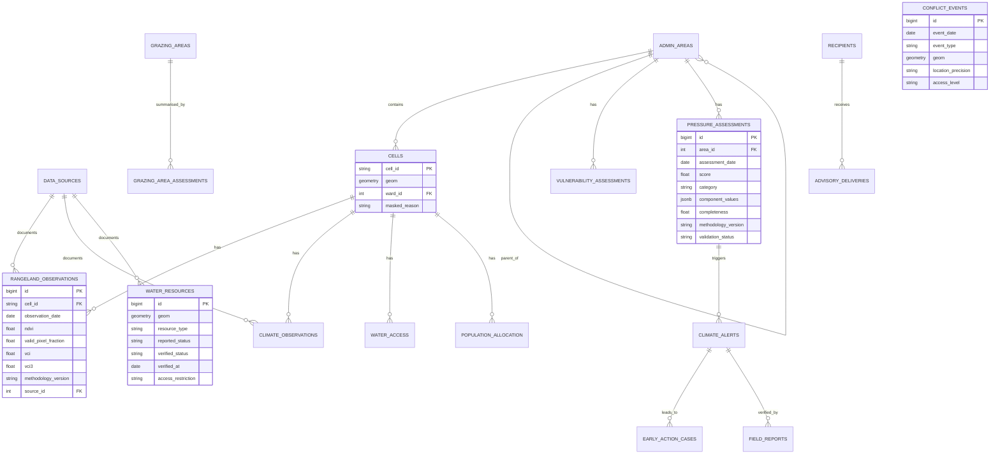
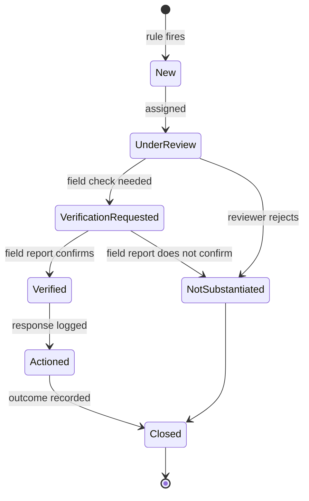
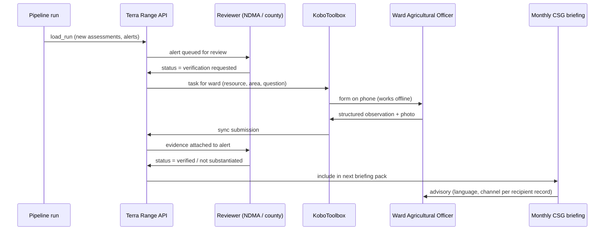

# Terra Range

**Earth observation and climate intelligence for rangeland resilience and anticipatory action.**

Pilot geography: **Marsabit County, Kenya** · Future scope: pastoral landscapes across the IGAD region


> Terra Range makes changing rangeland conditions visible at sub-ward resolution, links them to who may be affected, and routes verified signals to the people who can act on them. It does **not** predict conflict or livestock movement, and it never presents an unvalidated score as a probability.

---

## Table of contents

1. [What Terra Range answers](#1-what-terra-range-answers)
2. [System architecture](#2-system-architecture)
3. [Spatial framework](#3-spatial-framework)
4. [Data sources](#4-data-sources)
5. [Analysis pipeline](#5-analysis-pipeline)
6. [Mathematical methods](#6-mathematical-methods)
7. [Data model](#7-data-model)
8. [Alert logic and review workflow](#8-alert-logic-and-review-workflow)
9. [Last-mile delivery](#9-last-mile-delivery)
10. [API](#10-api)
11. [Repository structure](#11-repository-structure)
12. [Quick start](#12-quick-start)
13. [Validation plan](#13-validation-plan)
14. [Privacy, safeguards and responsible use](#14-privacy-safeguards-and-responsible-use)
15. [Known limitations](#15-known-limitations)
16. [Roadmap](#16-roadmap)

---

## 1. What Terra Range answers

| Question | Indicator family | Section |
|---|---|---|
| What is changing? | Vegetation, rainfall, surface water | [6.1 to 6.4](#6-mathematical-methods) |
| Who may be affected? | Population exposure and vulnerability | [6.6 to 6.7](#6-mathematical-methods) |
| Where is resource pressure rising? | Water access, grazing-area pressure | [6.5, 6.8, 6.9](#6-mathematical-methods) |
| What is the conflict context? | Independently documented events (restricted) | [6.11](#6-mathematical-methods) |
| What should happen next? | Rule-based alerts and verification tasks | [8](#8-alert-logic-and-review-workflow) |

### Design principles

- **Observed, derived and interpreted values stay separate**, in storage and in the UI.
- **Explainable over opaque.** Every composite exposes its components, weights, completeness and methodology version.
- **Missing is not zero.** Unavailable inputs are surfaced, never imputed silently.
- **Human review before consequence.** Alerts allocate attention; they do not decide.
- **Sensitive data is physically separated**, not just hidden in the UI.
- **Reproducible.** Every output traces to source files, code version and a methodology version.

---

## 2. System architecture



### Key architectural decisions

| Decision | Rationale |
|---|---|
| Pipeline and Django never import each other | The pipeline writes GeoParquet plus a manifest. A Django management command (`load_run`) ingests it. GDAL and raster stacks stay out of the web deployment, and every run is replayable. |
| Rasters stay as Cloud Optimized GeoTIFFs | Served through TiTiler. Only tabular results and vectors enter PostGIS. |
| Conflict data uses its own entrypoint, tables and permissions | It cannot be joined into a public layer by accident. |
| Thresholds, weights and species limits live in versioned YAML | A funder or reviewer can audit why a trigger fires by reading one file and its git history. |
| Kobo for field input | Reuses the tooling NDMA and NGOs already operate, instead of a bespoke offline-capable client. |

### Indicator dependency graph

The three columns never merge into a single score.



---

## 3. Spatial framework

Ward-level means hide most of what matters in a county of roughly 70,000 km². Terra Range computes everything on a **regular grid** and reports at ward level by rollup.

| Property | Value |
|---|---|
| Analysis CRS | EPSG:32637 (WGS 84 / UTM zone 37N), equal-area-adequate for the county |
| Storage CRS | EPSG:4326 for vectors served to the web |
| Cell size | 5 km × 5 km (25 km² per cell), roughly 2,800 cells before masking |
| Cell ID | Deterministic from grid origin: `c{row:03d}_{col:03d}` |
| Rollup units | Ward, constituency, county, and mapped grazing areas |
| Masks | Chalbi Desert, lava fields, Mt Marsabit forest, open water, settlements (configurable) |



**Resolution caveat.** CHIRPS is natively 0.05° (about 5.5 km). A 5 km cell does not make rainfall finer than its source; it only aligns rainfall with the vegetation and water layers. MODIS NDVI (250 m) is the layer that genuinely benefits from the grid.

**Why mask bare ground.** NDVI on sparse dryland surfaces has a poor signal-to-noise ratio. Masked cells are retained with a `masked_reason` and excluded from stress statistics, so coverage can be reported honestly.

---

## 4. Data sources

Every dataset is registered in `config/sources.yaml` and in the `data_sources` table. Licence, acquisition date, resolution and limitations are mandatory fields.

| Layer | Dataset | Native resolution | Notes |
|---|---|---|---|
| Vegetation | MODIS MOD13Q1 NDVI | 250 m, 16-day | Use the SummaryQA band for pixel masking; apply the 0.0001 scale factor |
| Rainfall | CHIRPS v2 | 0.05°, daily/pentad | Add CHIRPS-GEFS for short-range forward look |
| Surface water | JRC Global Surface Water | 30 m | Occurrence and seasonality bands; not a functionality indicator |
| Population | KNBS 2019 census; WorldPop constrained | ward / 100 m | KNBS provides control totals, WorldPop provides spatial distribution |
| Livelihood zones | FEWS NET Kenya | polygon | Drives vulnerability dimension weights |
| Food security | NDMA bulletins, IPC Kenya ASAL | county / ward | Primary validation ground truth |
| Markets | WFP VAM, NDMA market data | market-level, monthly | Goat/cattle/camel and maize prices |
| Water points | WPdx, OSM, county water department, WRA | point | `reported` and `verified` status stored separately |
| Movement | NDMA sentinel-site records, NRT grazing plans, partner collar data | varies | Requires data-sharing agreements; start early |
| Conflict | ACLED, UCDP, CEWERU/CEWARN (if authorised) | event | Restricted pipeline only |
| Connectivity | GSMA coverage, OpenCelliD | cell tower / polygon | Informs last-mile channel design |

Raw data is **immutable** and never committed. Each acquisition lands in `data/raw/<source>/<YYYY-MM-DD>/` with a checksum file.

---

## 5. Analysis pipeline



Each run writes a `manifest.json`:

```json
{
  "run_id": "2026-11-03T06:00:00Z_a1b2c3",
  "code_version": "git:4f9e1c2",
  "methodology_versions": {"vci": "1.0", "pressure": "0.3", "vulnerability": "0.2"},
  "inputs": [{"source_id": "modis_mod13q1", "sha256": "…", "period": ["2001-01-01", "2026-10-16"]}],
  "records": {"rangeland_observations": 118234, "climate_observations": 98211},
  "validation_failures": 0,
  "outputs": ["processed/rangeland_cell_2026-10.parquet"]
}
```

---

## 6. Mathematical methods

Notation: $i$ is a grid cell, $t$ a composite period, $d$ the position of a composite within the year (for example, 23 composites per year for MOD13Q1), $b$ the baseline period, $w$ a ward, $s$ a livestock species.

### 6.1 NDVI and valid-pixel handling

$$
\mathrm{NDVI} = \frac{\rho_{NIR} - \rho_{Red}}{\rho_{NIR} + \rho_{Red}}
$$

For each 250 m pixel $p$ inside cell $i$, a quality mask $q_p \in \{0, 1\}$ is derived from the QA band (cloud, shadow, snow/ice, aerosol). The **valid-pixel fraction** and the **cell NDVI** are:

$$
f_{i,t} = \frac{\sum_{p \in i} q_p \, a_p}{\sum_{p \in i} a_p}, \qquad
X_{i,t} = \frac{\sum_{p \in i} q_p \, a_p \, \mathrm{NDVI}_p}{\sum_{p \in i} q_p \, a_p}
$$

where $a_p$ is the area of pixel $p$ clipped to the cell. A cell value is published only if $f_{i,t} \ge f_{\min}$ (default 0.5). Otherwise it is stored as `NULL` with the reason, never as zero.

Cell NDVI is aggregated **before** computing VCI, which is more robust than averaging pixel-level VCI in noisy dryland conditions. A soil-adjusted alternative is evaluated in validation:

$$
\mathrm{SAVI} = \frac{(1+L)(\rho_{NIR} - \rho_{Red})}{\rho_{NIR} + \rho_{Red} + L}, \quad L = 0.5
$$

### 6.2 Vegetation Condition Index (VCI)

For each cell and composite position $d$, the baseline min and max are taken across years $y \in b$ (default 2001 to 2025):

$$
X^{\min}_{i,d} = \min_{y \in b} X_{i,d,y}, \qquad X^{\max}_{i,d} = \max_{y \in b} X_{i,d,y}
$$

$$
\mathrm{VCI}_{i,t} = 100 \cdot \frac{X_{i,t} - X^{\min}_{i,d}}{X^{\max}_{i,d} - X^{\min}_{i,d}}
$$

Guard: if $X^{\max}_{i,d} - X^{\min}_{i,d} < \varepsilon$ (a flat baseline), VCI is `NULL` with reason `flat_baseline`.

To damp single-composite noise and align with how drought monitoring is operationally reported, a trailing **3-month VCI** is used:

$$
\mathrm{VCI3}_{i,t} = \frac{1}{|\mathcal{W}_t|} \sum_{\tau \in \mathcal{W}_t} \mathrm{VCI}_{i,\tau}, \qquad \mathcal{W}_t = \{\text{valid composites in the 3 months ending at } t\}
$$

published only if $|\mathcal{W}_t| \ge m_{\min}$ (default 4 of 6 composites).

**Classification.** Class boundaries are read from `config/indicators.yaml`, never hard-coded:

```yaml
vci3_classes:        # ILLUSTRATIVE: confirm against the current NDMA bulletin methodology
  normal:    {min: 50}
  alert:     {min: 35, max: 50}
  alarm:     {min: 20, max: 35}
  emergency: {max: 20}
methodology_version: "1.0"
```

> NDMA's drought *phase* integrates several indicators (vegetation, rainfall, production, access, utilisation). Terra Range reproduces the **vegetation indicator class** and compares it to the published phase, rather than claiming to compute the phase itself.

### 6.3 Anomalies and standardised scores

$$
A_{i,t} = X_{i,t} - \mu_{i,d}, \qquad
Z_{i,t} = \frac{X_{i,t} - \mu_{i,d}}{\sigma_{i,d}}
$$

with $\mu_{i,d}$ and $\sigma_{i,d}$ the baseline mean and standard deviation for the same composite position. $Z$ is computed only if the baseline has at least $n_{\min}$ (default 15) valid years and $\sigma_{i,d} > \varepsilon$.

### 6.4 Rainfall indicators

**Percent of normal** over an accumulation window of $k$ months:

$$
\mathrm{PON}_{i,t}^{(k)} = 100 \cdot \frac{R^{(k)}_{i,t}}{\overline{R}^{(k)}_{i,m}}
$$

**Standardised Precipitation Index (SPI).** For each cell, calendar month $m$ and window $k$, fit a gamma distribution $G$ to the non-zero accumulated totals. With $q$ the empirical probability of zero rainfall:

$$
H(x) = q + (1 - q)\, G(x), \qquad \mathrm{SPI} = \Phi^{-1}\!\big(H(x)\big)
$$

where $\Phi^{-1}$ is the inverse standard normal CDF. Arid cells have frequent zero totals, so the zero-probability term $q$ is essential. SPI is reported for $k \in \{1, 3, 6\}$.

**Deficit duration** is the number of consecutive periods with $\mathrm{SPI}^{(1)} < -1$ (threshold configurable). It is reset only after two consecutive periods at or above the threshold, to avoid flicker.

**Lag test (the anticipatory component).** The question is whether a rainfall anomaly now carries information about vegetation change $k$ composites later. For each lag $k \in \{1,\dots,6\}$:

$$
\Delta \mathrm{VCI}_{i,t+k} = \alpha_k + \beta_k \,\mathrm{SPI}^{(1)}_{i,t} + \gamma_k \,\mathrm{VCI}_{i,t} + s(d) + \varepsilon_{i,t}
$$

where $s(d)$ is a seasonal term and the $\gamma_k$ term controls for starting condition. Evaluation uses **spatial block cross-validation** (hold out whole ward blocks) and **leave-one-year-out** splits, so autocorrelation does not inflate skill. Lag skill is reported as the cross-validated $R^2$ and as categorical skill against an event definition such as $\mathrm{VCI3}_{t+k} < 35$:

| | Event observed | Not observed |
|---|---|---|
| **Warned** | $a$ (hits) | $b$ (false alarms) |
| **Not warned** | $c$ (misses) | $d$ (correct negatives) |

$$
\mathrm{POD} = \frac{a}{a+c}, \quad
\mathrm{FAR} = \frac{b}{a+b}, \quad
\mathrm{CSI} = \frac{a}{a+b+c}, \quad
\mathrm{HSS} = \frac{2(ad - bc)}{(a+c)(c+d) + (a+b)(b+d)}
$$

Failures are reported alongside successes. If $\mathrm{HSS}$ is not meaningfully above zero out of sample, the lag signal is **not** used in alert rules.

### 6.5 Water access

**Travel time surface.** Walking speed over terrain follows Tobler's hiking function, with $S$ the slope (rise over run):

$$
v(S) = 6\, e^{-3.5\,\lvert S + 0.05 \rvert} \ \text{km/h}
$$

Cost-distance over a 250 m friction raster (slope, land cover, barriers such as the escarpment and lava fields) gives the travel time $T(i, w)$ from cell $i$ to water point $w$, computed with Dijkstra's algorithm.

**Species-specific reachability.** A herd must reach water and return within its watering interval. For species $s$ with typical daily trekking range $r_s$ (km/day) and maximum watering interval $I_s$ (days), the one-way reachable distance is:

$$
d^{\max}_s = \frac{r_s \cdot I_s}{2}
$$

Let $W_s(\text{season})$ be the set of water points that are mapped, **verified or reported-operational with recent verification**, and available in the season. The access measure is:

$$
\tau_{i,s} = \min_{w \in W_s(\text{season})} T(i, w), \qquad
\mathrm{Access}_{i,s} = \mathbf{1}\!\left[\tau_{i,s} \cdot v_s \le d^{\max}_s\right]
$$

Species parameters ($r_s$, $I_s$, dry and wet season values) live in `config/species.yaml` with a cited source for each value. Seasonal sources (pans, shallow wells) enter $W_s$ only for months in which JRC seasonality indicates water presence.

> Mapped distance is not actual access. It excludes land tenure, security constraints, queueing and functionality. The dashboard labels this indicator `Derived`, not `Verified`.

**Water-point density and verification recency** are reported per ward alongside the access result:

$$
\mathrm{VerifiedShare}_w = \frac{\#\{\text{points verified within } \Delta \text{ months}\}}{\#\{\text{mapped points}\}}
$$

### 6.6 Population exposure (dasymetric allocation)

An entire ward population is never assigned to a small stressed area. Instead, KNBS ward totals are distributed to cells in proportion to a settlement-weighted surface (WorldPop, masked to inhabitable cells):

$$
P_i = P_w \cdot \frac{\widehat{P}_i}{\sum_{j \in w} \widehat{P}_j}, \qquad i \in w
$$

where $\widehat{P}_i$ is the WorldPop zonal sum and $P_w$ the KNBS ward control total. Because the census is from 2019, a documented projection is applied and labelled `Estimated`:

$$
P_w(t) = P_w(2019) \,(1 + g)^{\,t - 2019}
$$

with $g$ the county growth rate from KNBS projections.

**Exposure** is the population in cells meeting a stress criterion, and **co-exposure** adds limited verified access:

$$
E_t = \sum_i P_i \cdot \mathbf{1}\!\left[\mathrm{VCI3}_{i,t} < \theta_{veg}\right], \qquad
E^{\text{access}}_t = \sum_i P_i \cdot \mathbf{1}\!\left[\mathrm{VCI3}_{i,t} < \theta_{veg}\right] \cdot \big(1 - \mathrm{Access}_{i,s^*}\big)
$$

where $s^*$ is the dominant livestock species in the cell's livelihood zone. Exposure and vulnerability are always stored and shown separately.

### 6.7 Vulnerability

Components are normalised against **fixed reference bounds** (stored in config, not computed from the current sample), so scores are comparable across time and not rescaled by who happens to be in the dataset:

$$
\tilde{x}_{ik} = \operatorname{clip}\!\left(\frac{x_{ik} - x_k^{lo}}{x_k^{hi} - x_k^{lo}},\, 0,\, 1\right), \qquad
\text{flipped as } 1 - \tilde{x}_{ik} \text{ for protective indicators}
$$

so that higher always means more vulnerable. Candidate components:

| Dimension | Example indicator |
|---|---|
| Livelihood dependence | Share of livelihood zone classified pastoral/agro-pastoral |
| Water access | $1 - \mathrm{Access}$ or mean $\tau$ |
| Food security | NDMA/IPC phase, coping strategy index where available |
| Livestock condition | Sentinel-site body condition, milk production |
| Market position | Terms of trade (below) |
| Service access | Travel time to nearest health facility and market |

**Terms of trade** (goat for maize), a leading rather than lagging indicator:

$$
\mathrm{ToT}_t = \frac{P^{goat}_t}{P^{maize}_t} \ \ [\text{kg maize per goat}], \qquad
z^{ToT}_t = \frac{\mathrm{ToT}_t - \overline{\mathrm{ToT}}_{m}}{s_{m}}
$$

**Composite with explicit missing-data handling.** Let $K_i$ be the set of components available for cell or ward $i$:

$$
V_i = \frac{\sum_{k \in K_i} w_k \,\tilde{x}_{ik}}{\sum_{k \in K_i} w_k}, \qquad
C_i = \frac{\sum_{k \in K_i} w_k}{\sum_{k} w_k}
$$

$C_i$ is the **completeness**. The composite is published only if $C_i \ge C_{\min}$ and every component flagged `critical` is present. Otherwise it is stored as unavailable and the components are shown alone.

**Weight sensitivity.** Weights $\mathbf{w}$ are perturbed by sampling from a Dirichlet distribution centred on the baseline weights $\mathbf{w}_0$:

$$
\mathbf{w}^{(r)} \sim \mathrm{Dir}(\kappa\, \mathbf{w}_0), \qquad r = 1,\dots,R
$$

and the stability of the ranking is measured by Kendall's $\tau$ between the baseline and each perturbed ranking. A composite is published only if median $\tau$ exceeds a threshold agreed with reviewers. If rankings are unstable, only components are shown.

### 6.8 Resource pressure

$$
P_i = \frac{\sum_{k \in K_i} w_k \, r_{ik}}{\sum_{k \in K_i} w_k}, \qquad r_{ik} \in [0, 1]
$$

| Component $r_{ik}$ | Definition (higher is more pressure) |
|---|---|
| Vegetation stress | $1 - \mathrm{VCI3}_{i,t}/100$ |
| Rainfall deficit | $\operatorname{clip}\big((-\mathrm{SPI}^{(3)}_{i,t}) / 2, 0, 1\big)$ |
| Water scarcity | $1 - \mathrm{Access}_{i,s^*}$ or normalised $\tau$ |
| Dependence | Normalised population per verified water point (only if reliable data exists) |

The same completeness and publication rules as 6.7 apply. The output is a **category with visible components and a methodology version**, not a probability. If data is insufficient the category is `Insufficient data`.

### 6.9 Movement context (descriptive, not predictive)

Seasonal grazing areas $g$ (dry-season refuges, wet-season dispersal areas) and corridors are mapped from participatory sources and sentinel-site records. For each grazing area, with $\mathcal{C}_g$ the set of its unmasked cells and $a_i$ the cell area:

$$
\overline{\mathrm{VCI3}}_g = \frac{\sum_{i \in \mathcal{C}_g} a_i \,\mathrm{VCI3}_i}{\sum_{i \in \mathcal{C}_g} a_i}, \qquad
\mathrm{StressedFraction}_g = \frac{\sum_{i \in \mathcal{C}_g} a_i \,\mathbf{1}[\mathrm{VCI3}_i < \theta_{veg}]}{\sum_{i \in \mathcal{C}_g} a_i}
$$

$$
\mathrm{WaterCover}_g = \frac{\sum_{i \in \mathcal{C}_g} a_i \,\mathrm{Access}_{i,s}}{\sum_{i \in \mathcal{C}_g} a_i}
$$

These summarise *conditions on a grazing area*. They do not forecast where herds will go. A mismatch (for example, a dry-season refuge with falling $\overline{\mathrm{VCI3}}_g$ and low $\mathrm{WaterCover}_g$) is flagged for **local verification with herder representatives**.

### 6.10 Cell-to-ward rollup

Ward values are area-weighted over valid, unmasked cells, with coverage reported:

$$
Y_w = \frac{\sum_{i \in w} a_i \, m_i \, Y_i}{\sum_{i \in w} a_i \, m_i}, \qquad
\mathrm{Coverage}_w = \frac{\sum_{i \in w} a_i \, m_i}{\sum_{i \in w} a_i \, u_i}
$$

with $m_i = 1$ if cell $i$ has a valid value and $u_i = 1$ if it is unmasked. The map also shows the **within-ward spread** (for example the 10th and 90th percentile of cell VCI3), so a single ward colour never implies uniform conditions.

### 6.11 Conflict context (restricted)

Event records are aggregated by cell group and period for **context**, not scoring. Two safeguards are mathematical:

1. **No probability from counts.** Raw event counts $N_{i,t}$ confound conflict with reporting coverage, population and accessibility. No rate such as $N_{i,t}/P_i$ is presented as risk.
2. **Overlap tests, not causal claims.** To check whether documented events overlap with environmental stress more than chance, a permutation test is used. With $T$ the observed overlap statistic (for example, the fraction of events falling in cells with $\mathrm{VCI3} < \theta$):

$$
p = \frac{1 + \#\{r : T^{(r)} \ge T\}}{1 + R}
$$

where $T^{(r)}$ is recomputed after randomly permuting event locations within reporting-coverage strata. Any result is reported with its coverage caveats and is never used to trigger an alert automatically.

---

## 7. Data model



`CONFLICT_EVENTS` and sensitive `FIELD_REPORTS` live in the `restricted` Django app, with their own database role and permission classes. Rules that apply across the schema:

- Stable primary keys and a `source_id` plus `methodology_version` on every derived row.
- Spatial (GiST) indexes on geometries; B-tree indexes on `(cell_id, observation_date)`.
- Migrations for all schema changes; idempotent upserts for loads.
- Explicit status vocabulary: `Observed`, `Derived`, `Estimated`, `Reported`, `Verified`, `Illustrative`, `Insufficient data`.

---

## 8. Alert logic and review workflow

Rules are declarative and live in `config/indicators.yaml`.

```yaml
rules:
  - id: veg_stress_persistent
    inputs: [vci3]
    condition: "vci3 < 35 for >= 2 consecutive composites"
    min_completeness: 0.7
    severity_map: {"35>x>=20": "watch", "x<20": "high"}
    recipients: [ndma_county, ward_agri_officer]
    expiry: "re-evaluate each composite; close after 2 composites >= 50"
    methodology_version: "1.0"
```

Generic persistence rule, with $\tau$ the threshold, $n$ the required persistence and $C_{\min}$ the completeness floor:

$$
\mathrm{Trigger}_{i,t} = \mathbf{1}\!\left[\ \bigwedge_{j=0}^{n-1} \big(\mathrm{VCI3}_{i,t-j} < \tau\big) \ \wedge \ C_{i,t} \ge C_{\min}\ \right]
$$

Environmental triggers and conflict-related reports remain **separate rule families**. Environmental stress never produces a conflict alert.



Every transition is recorded in the case's `review_history` with actor, timestamp and note.

---

## 9. Last-mile delivery

Last-mile design is treated as research as well as engineering.



**Recipient records** (`fieldwork` app) hold ward, role, language, preferred channel and **consent flags**. The consent fields exist before any SMS or WhatsApp integration is built.

Channels evaluated during discovery: monthly NDMA County Steering Group meetings, SMS, WhatsApp, radio and barazas. The channel a ward actually uses is a data collection output, not an assumption.

Languages for advisory content are managed in `frontend/i18n/` and the advisory templates: English, Swahili, and local languages such as Borana, Gabra and Rendille, translated and reviewed by native speakers rather than machine-translated.

---

## 10. API

Base path: `/api/v1/`. Missing data is returned as explicit `null` plus a `data_status`, never as an invented value.

| Endpoint | Purpose |
|---|---|
| `GET /areas/`, `/areas/{id}/` | Administrative areas and profiles |
| `GET /cells/` | Grid cells with ward and mask information |
| `GET /rangelands/observations/`, `/rangelands/summary/` | Vegetation observations and rollups |
| `GET /climate/observations/`, `/climate/summary/` | Rainfall, SPI, deficits |
| `GET /resources/water/` | Water resources with reported and verified status |
| `GET /population/statistics/` | Population (labelled by reference year and estimate type) |
| `GET /vulnerability/` | Components and, where published, the composite |
| `GET /resource-pressure/` | Components, completeness, methodology version |
| `GET /movement/grazing-areas/` | Grazing-area condition summaries |
| `GET /alerts/`, `/alerts/{id}/` | Alerts and their evidence |
| `GET /dashboard/summary/` | KPI values with reporting period and quality status |
| `GET /data-quality/` | Coverage and provenance |
| `GET /health/` | Service and database health |
| `GET /restricted/conflict-context/` | **Authenticated and authorised only** |

Common filters: `area_id`, `area_type`, `start_date`, `end_date`, `indicator`, `category`, `severity`, `verification_status`, `data_status`.

---

## 11. Repository structure

```text
terra-range/
├── README.md
├── Makefile
├── docker-compose.yml
├── .env.example
│
├── config/
│   ├── pilot.yaml              # AOI, CRS, grid size, baseline years
│   ├── indicators.yaml         # thresholds, weights, rules, methodology_version
│   ├── species.yaml            # watering intervals and trekking ranges, with citations
│   └── sources.yaml            # machine-readable source register
│
├── data/                       # gitignored except demo/
│   ├── raw/                    # immutable, per source and acquisition date
│   ├── interim/
│   ├── processed/              # GeoParquet + manifest.json per run
│   └── demo/
│
├── pipeline/                   # package: terrarange
│   ├── pyproject.toml
│   ├── terrarange/
│   │   ├── core/               # config, CRS helpers, run log, provenance
│   │   ├── grid/               # build_grid.py, masks.py
│   │   ├── acquire/            # gee/, ndma_bulletins.py, wpdx_osm_water.py, markets.py, kobo_pull.py
│   │   ├── validate/
│   │   ├── indicators/         # rangeland, climate, water_access, exposure,
│   │   │                       # vulnerability, movement, pressure
│   │   ├── restricted/         # conflict pipeline, separate entrypoint
│   │   ├── validation_vs_ndma/
│   │   └── export/
│   ├── tests/
│   └── notebooks/
│
├── backend/                    # Django; no raster libraries
│   ├── manage.py
│   ├── config/
│   └── apps/
│       ├── geography/          # areas, cells, grazing areas, corridors, sources
│       ├── observations/       # rangeland, climate, water, population, markets
│       ├── assessments/        # vulnerability, pressure, alerts, action cases
│       ├── fieldwork/          # Kobo sync, advisories, recipients, channels, consent
│       └── restricted/         # conflict events, sensitive field reports
│
├── frontend/
│   ├── index.html
│   ├── pages/
│   ├── js/
│   ├── css/
│   └── i18n/
│
├── briefings/                  # monthly CSG briefing templates and generator
├── docs/                       # methodology, data dictionary, safeguards, validation plan
├── ops/                        # tile server config, backups, deployment notes
└── .github/workflows/
```

---

## 12. Quick start

> Status: design stage. The commands below describe the intended workflow and will be filled in as modules land.

```bash
# 1. Environment
git clone https://github.com/<org>/terra-range.git && cd terra-range
cp .env.example .env
docker compose up -d postgis

# 2. Pipeline environment (heavy geospatial dependencies live here only)
python -m venv .venv-pipeline && source .venv-pipeline/bin/activate
pip install -e pipeline/

# 3. Build the analysis grid and masks
make grid

# 4. Acquire data (Earth Engine exports run on your side; place outputs in data/raw/)
python -m terrarange.acquire.gee.modis_ndvi --start 2001-01-01 --end 2026-10-16
python -m terrarange.acquire.gee.chirps    --start 1991-01-01 --end 2026-10-16

# 5. Validate, compute indicators, export
make validate
make vci
make climate
make export

# 6. Backend and loading
python -m venv .venv-backend && source .venv-backend/bin/activate
pip install -r backend/requirements.txt
python backend/manage.py migrate
python backend/manage.py load_run data/processed/<run_id>/manifest.json

# 7. Serve
python backend/manage.py runserver
make briefing MONTH=2026-10
```

Run tests:

```bash
pytest pipeline/tests
python backend/manage.py test
```

---

## 13. Validation plan

| Check | Method | Pass criterion (set before running) |
|---|---|---|
| Vegetation class agreement | Cell VCI3 rolled to ward, compared with NDMA published vegetation class, last 12 to 24 months | Agreement rate and confusion matrix reported; disagreements explained |
| Lag skill | Spatial-block and leave-one-year-out cross-validation; POD, FAR, CSI, HSS | HSS above zero out of sample; otherwise lag is excluded from alerts |
| Weight robustness | Dirichlet sensitivity, Kendall's $\tau$ | Median $\tau$ above agreed threshold; else components only |
| Water access | Compare with NDMA sentinel-site trekking distances and field verification | Systematic bias documented |
| Exposure | Sum of cell allocations equals ward total (conservation check) | $\sum_{i \in w} P_i = P_w$ within rounding |
| Pipeline integrity | Idempotent re-runs, schema and CRS checks, nodata handling | All tests green; re-run produces identical outputs |
| Usability | Walkthroughs with NDMA staff, county officers and ward officers | Task completion and comprehension recorded |

Dataset disagreements are documented, not forced to match.

---

## 14. Privacy, safeguards and responsible use

1. Minimise personal data collection; prefer aggregated population statistics.
2. No identifiable household or informant information in general tables.
3. Conflict events and sensitive field reports are restricted by role, with generalised locations where needed.
4. Role-based access control, access and change logs, encrypted transport, secrets outside the repository.
5. Define retention and deletion procedures; assess obligations under Kenya's **Data Protection Act, 2019** before enabling any community reporting or messaging.
6. Respect source licences and data-sharing agreements.
7. No community, ethnic group or livelihood is labelled inherently conflict-prone. Vulnerability scores are never used to deny services, restrict movement or justify coercive action.
8. A public view shows aggregated trends only.

---

## 15. Known limitations

- Vegetation indices indicate vegetation properties, not forage biomass or carrying capacity.
- CHIRPS is about 5.5 km; rainfall does not gain resolution from the 5 km grid.
- Mapped water access is not functional or socially available access.
- Census-based population is a projection, not a current count.
- Public conflict datasets under-report in remote areas; cross-border data (for example Ethiopia) is thin.
- A short NDMA validation window (12 to 24 months) limits statistical power.
- The system supports verification and preparedness; it does not forecast conflict or livestock movement.

---

## 16. Roadmap

| Phase | Focus | Deliverable |
|---|---|---|
| 1 | Config, grid, masks, Earth Engine exports, VCI | Reproducible cell-level VCI for Marsabit |
| 2 | NDMA validation, rainfall indicators, lag test | Validation report; go/no-go on anticipatory signal |
| 3 | PostGIS, Django API, map, trend charts, briefing PDF | Demonstrable dashboard slice |
| 4 | Water access, dasymetric exposure, vulnerability components | Exposure and vulnerability viewable side by side |
| 5 | Movement context, resource-pressure rules | Grazing-area summaries with verification prompts |
| 6 | Alerts, Kobo integration, recipient and consent records | Observation-to-action path with audit trail |
| 7 | Restricted conflict-context pipeline and access controls | Separate, permissioned context layer |
| 8 | Pilot evaluation | Evaluation report and expansion roadmap |

---

## Licence and contribution

To be defined. Data licences are independent of the code licence; see `config/sources.yaml` for per-dataset terms.

**Terra Range should make it easier to see changing conditions, understand who may be affected, examine the evidence and support earlier, better-informed action, without claiming certainty that the data cannot provide.**