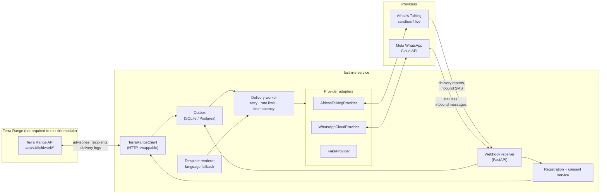
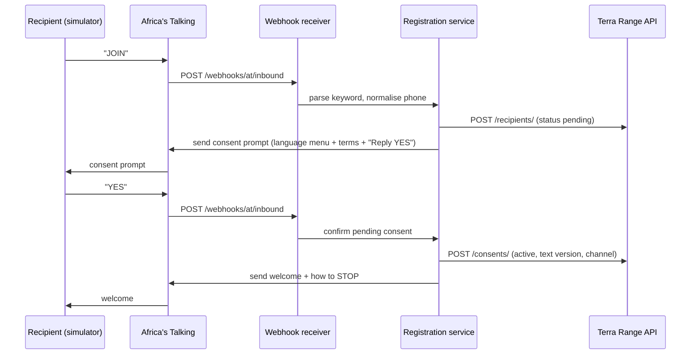
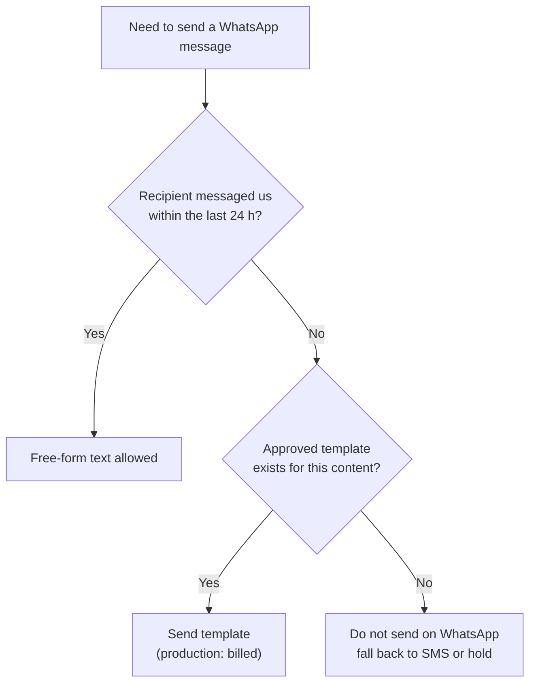
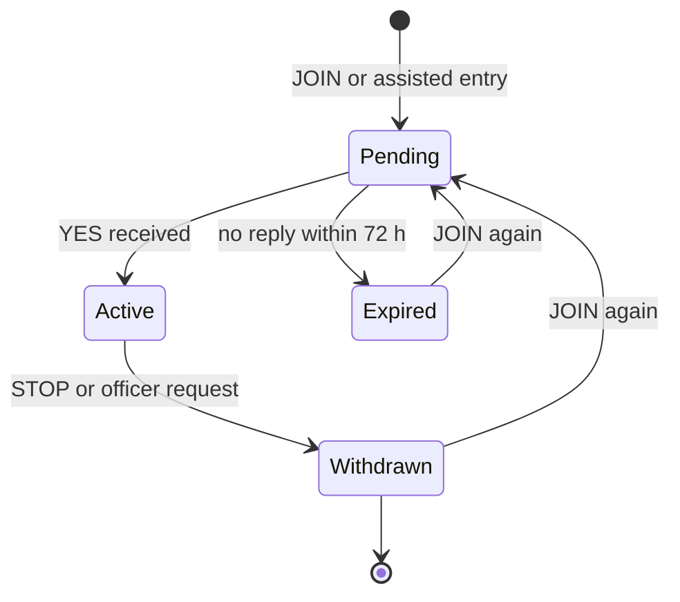
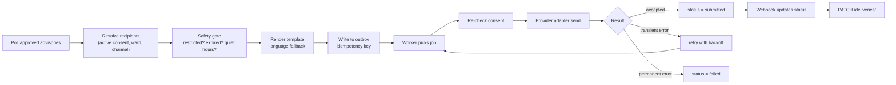
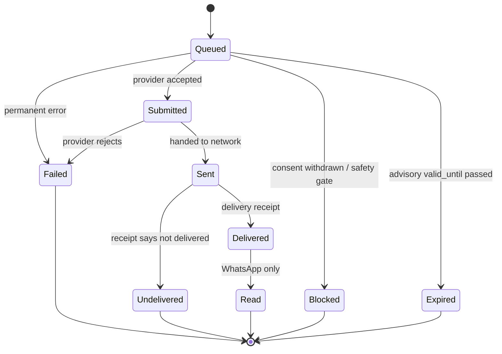

# Terra Range: Last-Mile Delivery Layer

**Registration, consent, and SMS / WhatsApp delivery of verified advisories to ward-level responders in Marsabit County, Kenya.**

This module can be built, run and tested **without the rest of Terra Range**. It talks to the main platform only through a documented HTTP contract, and ships with a mock of that contract so you are never blocked waiting for real endpoints.


---

## Table of contents

1. [Scope and who this is for](#1-scope-and-who-this-is-for)
2. [What "free" actually means](#2-what-free-actually-means)
3. [Architecture](#3-architecture)
4. [The independence contract (mock endpoints)](#4-the-independence-contract-mock-endpoints)
5. [Registration and consent](#5-registration-and-consent)
6. [Sending pipeline](#6-sending-pipeline)
7. [Webhooks](#7-webhooks)
8. [Provider setup](#8-provider-setup)
9. [Repository layout](#9-repository-layout)
10. [Local quick start](#10-local-quick-start)
11. [Testing strategy](#11-testing-strategy)
12. [Contributing](#12-contributing)
13. [Safety and privacy rules (non-negotiable)](#13-safety-and-privacy-rules-non-negotiable)
14. [Handoff checklist: when real endpoints arrive](#14-handoff-checklist-when-real-endpoints-arrive)
15. [Open questions](#15-open-questions)

---

## 1. Scope and who this is for

### In scope

- Registering recipients and recording **consent** per channel and language.
- Sending approved advisories by **SMS** and **WhatsApp**.
- Receiving inbound messages (join, stop, help, language change, simple field replies).
- Tracking delivery status and reporting it back to Terra Range.
- Provider-agnostic design so channels can be swapped or added.

### Out of scope (for now)

- Deciding *what* to send or *to whom*. Terra Range decides that. This layer delivers.
- Conflict-related content. It is never sent over these channels.
- Bulk messaging to the general community. **Phase 1 recipients are professional responders only** (ward agricultural officers, livestock officers, County Steering Group members, ward climate committee focal persons). Community messaging requires a data-protection assessment first.
- Paid, production-grade providers. This README targets free tiers and sandboxes.

### Who this is for

An external collaborator who wants to build and test the delivery pipeline on their own machine, with their own free provider accounts, and hand back a module that plugs into Terra Range when its endpoints go live.

---

## 2. What "free" actually means

"Free" here means **free for development and testing**. Reaching real phones at production scale generally costs money, and the README is explicit about where the boundary is. Provider terms change, so verify each row against the provider's current documentation before you rely on it.

| Channel | Free option | What you get | What you do **not** get |
|---|---|---|---|
| SMS | **Africa's Talking sandbox** | Full API behaviour, 2-way short codes, delivery-report callbacks, a web/Android simulator | Messages go to the **simulator, not real handsets**. Live SMS is charged per message. |
| WhatsApp | **Meta WhatsApp Cloud API test number** | A test business number that can send free messages to **up to 5 verified recipient numbers**, with pre-approved template(s) | Real recipients beyond those 5. Test access tokens are short-lived (a temporary token that expires in roughly 24 hours is typical). Production use is billed per message by category, with service-window replies free. |
| Both | **Fake provider (in this repo)** | Zero-account, offline, deterministic testing of everything except real network behaviour | Real carrier behaviour |

Practical consequences:

- You can build and verify **everything** (registration, consent, encoding, retries, webhooks, status mapping) with the fake provider and the two sandboxes, at no cost.
- Seeing a message arrive on a **real** phone is only possible on WhatsApp (to your 5 test numbers). For SMS, a real-handset test needs a paid Africa's Talking live account or another real-SIM path, which is outside this README. Treat that as a pilot-phase decision for the Terra Range team, not a blocker for you.
- Do not design around features that only exist on paid tiers.
- WhatsApp production pricing is per message and has changed repeatedly. One 2026 pricing summary reports 1,000 free service messages per month per number from 1 October 2026. Treat that as **unverified until confirmed on Meta's pricing page**.

---

## 3. Architecture



### Design rules

1. **Core never imports a provider SDK directly.** Adapters implement one interface (section 6.1). Swapping a provider is an adapter change.
2. **Outbox pattern.** A message is written to the outbox *before* any network call. The worker sends from the outbox. A crash cannot lose or duplicate a send.
3. **Idempotency keys** on every outbound message so retries never produce duplicates.
4. **Consent is checked at send time**, not just at registration time. A withdrawn recipient is never messaged, even if a job was queued earlier.
5. **No Django, no PostGIS** in this module. Pure Python plus FastAPI and SQLite for local work.

---

## 4. The independence contract (mock endpoints)

Terra Range's real fieldwork endpoints do not exist yet. This module is written against `openapi/fieldwork.yaml`, and a **mock server** in `mock_api/` implements it with fixtures. When the real endpoints arrive, you change a base URL, not your code.

### 4.1 Endpoints you consume

Base path: `/api/v1/fieldwork/`. Auth: `Authorization: Token <token>` (the mock accepts any non-empty token).

| Method | Path | Purpose |
|---|---|---|
| `GET` | `/advisories/?status=approved&since=<iso>` | Advisories approved by a human reviewer and ready to send |
| `GET` | `/recipients/?ward_id=&channel=&consent=active` | Recipients with active consent for a channel |
| `POST` | `/recipients/` | Create a recipient (registration) |
| `PATCH` | `/recipients/{id}/` | Update language, ward, preferred channel |
| `POST` | `/consents/` | Record a consent event (grant) |
| `POST` | `/consents/{id}/withdraw/` | Record withdrawal |
| `POST` | `/deliveries/` | Log a send attempt |
| `PATCH` | `/deliveries/{id}/` | Update delivery status from provider callbacks |
| `POST` | `/inbound/` | Forward an inbound message for Terra Range to process |
| `GET` | `/health/` | Liveness |

### 4.2 Example payloads

**Approved advisory** (what you read):

```json
{
  "id": "adv_2026_10_0042",
  "alert_id": "alt_8841",
  "ward_id": "ward_north_horr",
  "severity": "watch",
  "valid_from": "2026-11-03T06:00:00Z",
  "valid_until": "2026-11-17T06:00:00Z",
  "approved_by": "reviewer_ndma_01",
  "approved_at": "2026-11-03T07:12:00Z",
  "content": {
    "en": "Vegetation condition in North Horr ward is below normal. Please verify water points and grazing areas this week and report using the field form.",
    "sw": "Hali ya mimea katika wadi ya North Horr iko chini ya kawaida. Tafadhali thibitisha vyanzo vya maji na maeneo ya malisho wiki hii."
  },
  "channels_allowed": ["sms", "whatsapp"],
  "contains_restricted_content": false
}
```

**Recipient with consent state** (what you read and write):

```json
{
  "id": "rcp_0019",
  "name": "Test Officer A",
  "role": "ward_agricultural_officer",
  "ward_id": "ward_north_horr",
  "phone_e164": "+254700000019",
  "language": "sw",
  "preferred_channel": "whatsapp",
  "consents": [
    {
      "id": "cns_0031",
      "channel": "sms",
      "status": "active",
      "consent_text_version": "v1",
      "captured_via": "inbound_keyword",
      "captured_at": "2026-10-20T08:03:11Z",
      "withdrawn_at": null
    }
  ]
}
```

**Delivery log** (what you write):

```json
{
  "advisory_id": "adv_2026_10_0042",
  "recipient_id": "rcp_0019",
  "channel": "sms",
  "provider": "africastalking",
  "provider_message_id": "ATXid_abc123",
  "idempotency_key": "adv_2026_10_0042:rcp_0019:sms:v1",
  "status": "submitted",
  "segments": 2,
  "attempt": 1,
  "error": null,
  "updated_at": "2026-11-03T07:15:02Z"
}
```

### 4.3 Rules of the contract

- **Phone numbers in fixtures are synthetic** (`+2547000000NN`). Never commit a real number, name or token.
- Fields may be added to responses without notice. **Ignore unknown fields**; never fail on them.
- Fields in the OpenAPI spec will not be removed or retyped without a version bump.
- `contains_restricted_content: true` means **do not send**. Refuse and log. See section 13.
- The mock can simulate failures: send header `X-Mock-Fail: 500`, `429` or `timeout` to exercise your retry logic.

### 4.4 Keeping the mock honest

`pytest -m contract` runs [Schemathesis](https://schemathesis.readthedocs.io) against the mock using the OpenAPI file. The Terra Range team will run the same suite against the real API when it exists. If the suite passes on both, integration is a configuration change.

---

## 5. Registration and consent

### 5.1 Principles

- **Opt-in, per channel.** Consenting to SMS does not imply WhatsApp.
- **Explicit and versioned.** Each consent stores the version of the consent text the person saw, so wording changes can be audited.
- **Withdrawal is as easy as joining.** `STOP` on any channel withdraws that channel immediately.
- **Language is captured at registration** and drives template selection.
- **Purpose-limited.** Consent covers environmental advisories and verification requests. It does not cover anything else.
- Kenya's **Data Protection Act, 2019** applies to personal data processing. This README is engineering guidance, not legal advice. Have the Terra Range team confirm lawful basis, retention and registration obligations before any real-recipient pilot.

### 5.2 Registration paths

| Path | When | Notes |
|---|---|---|
| **Self-registration by keyword** | Recipient texts `JOIN` to the short code, or WhatsApp `JOIN` to the business number | Works on sandbox simulators |
| **Officer-assisted registration** | A coordinator registers a recipient at a CSG meeting or training using the field form | Consent captured with `captured_via = assisted_form` and the assisting person recorded |
| **Bulk import** | Pre-approved professional list from a county office | Still requires a confirmation message and a recipient `YES` before status becomes `active` |

### 5.3 Keyword registration flow (SMS)



### 5.4 WhatsApp registration and the 24-hour window

When a recipient **messages the business number first**, WhatsApp opens a customer-service window (24 hours) in which you may send free-form replies. Registration should use this: a `JOIN` from the user opens the window, so your consent prompt can be ordinary text rather than a pre-approved template.



On the Meta **test number**, templates available are limited and recipients must be added and verified in the developer dashboard first (maximum 5). Custom templates may need Meta review, so use the `hello_world` template and the fake provider while approvals are pending.

### 5.5 Reserved keywords

Keywords are matched case-insensitively after trimming whitespace and punctuation, and live in `config/keywords.yaml`.

| Intent | English | Swahili (placeholder, review with native speakers) |
|---|---|---|
| Join | `JOIN` | `JIUNGE` |
| Confirm | `YES` | `NDIYO` |
| Stop | `STOP` | `ACHA` |
| Help | `HELP` | `MSAADA` |
| Language | `LANG EN`, `LANG SW` | `LUGHA EN`, `LUGHA SW` |

Local-language keywords (Borana, Gabra, Rendille) must be agreed with native-speaker reviewers. **Do not machine-translate advisory or consent text.** `STOP` must always work regardless of language.

### 5.6 Consent record



Only `Active` consent permits sending. A phone number appearing in a bulk list is **not** consent.

### 5.7 Phone number normalisation

Normalise every number to E.164 before storage and comparison. Kenyan mobile numbers are `+254` followed by nine digits starting with `7` or `1`.

```python
import re

KE_E164 = re.compile(r"^\+254[17]\d{8}$")

def normalise_ke(raw: str) -> str | None:
    digits = re.sub(r"[^\d+]", "", raw or "")
    if digits.startswith("+254"):
        candidate = digits
    elif digits.startswith("254"):
        candidate = "+" + digits
    elif digits.startswith("0") and len(digits) == 10:
        candidate = "+254" + digits[1:]
    elif len(digits) == 9 and digits[0] in "71":
        candidate = "+254" + digits
    else:
        return None
    return candidate if KE_E164.match(candidate) else None
```

Test cases to include: `0712 345 678`, `+254 712 345 678`, `254712345678`, `0112345678`, `712345678`, an overlong string, an empty string, and a non-Kenyan number (must return `None`).

---

## 6. Sending pipeline



### 6.1 Provider interface

```python
from dataclasses import dataclass
from typing import Protocol

@dataclass(frozen=True)
class OutboundMessage:
    idempotency_key: str
    to_e164: str
    body: str
    channel: str                    # "sms" | "whatsapp"
    template_name: str | None = None
    template_lang: str | None = None

@dataclass(frozen=True)
class SendResult:
    accepted: bool
    provider_message_id: str | None
    retryable: bool
    error: str | None = None

@dataclass(frozen=True)
class StatusEvent:
    provider_message_id: str
    status: str                     # normalised, see 6.4
    raw: dict

class Provider(Protocol):
    name: str
    def send(self, msg: OutboundMessage) -> SendResult: ...
    def parse_status(self, payload: dict) -> list[StatusEvent]: ...
    def parse_inbound(self, payload: dict) -> list["InboundMessage"]: ...
```

Every adapter must pass the shared adapter contract tests in `tests/providers/contract_suite.py`.

### 6.2 SMS length and cost maths

SMS billing and delivery depend on **segments**. Messages using only GSM-7 characters fit 160 characters in one segment, or 153 per segment when concatenated. If any character falls outside GSM-7 (for example some accented letters or smart quotes), the whole message switches to UCS-2: 70 characters in one segment, or 67 per segment when concatenated. Characters in the GSM-7 extension table (such as `{`, `}`, `[`, `]`, `\`, `^`, `~`, `|`, `€`) cost two septets.

$$
\text{segments} =
\begin{cases}
1 & L \le L_1 \\
\left\lceil \dfrac{L}{L_c} \right\rceil & L > L_1
\end{cases}
\qquad
(L_1, L_c) =
\begin{cases}
(160, 153) & \text{GSM-7} \\
(70, 67) & \text{UCS-2}
\end{cases}
$$

where $L$ is the length in septets (GSM-7) or UTF-16 code units (UCS-2).

```python
GSM7_BASIC = set(
    "@£$¥èéùìòÇ\nØø\rÅåΔ_ΦΓΛΩΠΨΣΘΞÆæßÉ !\"#¤%&'()*+,-./0123456789:;<=>?"
    "¡ABCDEFGHIJKLMNOPQRSTUVWXYZÄÖÑܧ¿abcdefghijklmnopqrstuvwxyzäöñüà"
)
GSM7_EXT = set("^{}\\[~]|€\f")

def sms_segments(text: str) -> tuple[int, str]:
    if all(c in GSM7_BASIC or c in GSM7_EXT for c in text):
        length = sum(2 if c in GSM7_EXT else 1 for c in text)
        enc, single, multi = "gsm7", 160, 153
    else:
        length = len(text.encode("utf-16-le")) // 2
        enc, single, multi = "ucs2", 70, 67
    if length <= single:
        return 1, enc
    return -(-length // multi), enc
```

Engineering consequences:

- **Normalise punctuation** in templates (straight quotes, plain hyphens) so a single smart quote does not triple the segment count.
- A CI check fails any SMS template over **3 segments** in any language.
- Log `segments` and `encoding` on every delivery. This is how the Terra Range team will estimate live-SMS cost later.

### 6.3 Retry and rate limiting

Transient failures (network errors, HTTP 429, HTTP 5xx) are retried with capped exponential backoff and jitter:

$$
t_n = \min\!\left(t_{\max},\ t_0 \cdot 2^{\,n}\right) + U(0,\ j\, t_0 \cdot 2^{\,n}), \qquad n = 0, 1, 2, \dots
$$

Defaults: $t_0 = 5$ s, $t_{\max} = 15$ min, $j = 0.25$, maximum 6 attempts. After the last attempt the job moves to a dead-letter state and is reported, never silently dropped. Honour any `Retry-After` header when present.

Outbound rate is limited per provider with a token bucket (capacity $B$, refill rate $r$ tokens per second). A send needs one token. Start conservatively and make both values configuration, since sandbox and live limits differ.

### 6.4 Status model

Normalised statuses are provider-independent:



Provider mapping (verify against current provider docs and add fixtures for each case):

| Normalised | Africa's Talking (typical) | WhatsApp Cloud API |
|---|---|---|
| `submitted` | `Submitted`, `Buffered` | API response accepted |
| `sent` | `Sent` | `sent` |
| `delivered` | `Success` | `delivered` |
| `read` | n/a | `read` |
| `failed` / `undelivered` | `Failed`, `Rejected` (with reason) | `failed` (with error code) |

### 6.5 Fallback policy

If a WhatsApp message is not `delivered` within a configurable window (default 30 minutes) and the recipient also has **active SMS consent**, the worker may send an SMS version. Fallback is per advisory and recorded in the delivery log. It never crosses to a channel without active consent.

Reach metrics reported back to Terra Range per advisory:

$$
\text{DeliveryRate} = \frac{N_{\text{delivered}}}{N_{\text{attempted}}}, \qquad
\text{Coverage} = \frac{N_{\text{active consented recipients in ward}}}{N_{\text{expected responders in ward}}}
$$

Coverage matters as much as delivery: a 100% delivery rate to a 40% registered population is not a 100% reach.

---

## 7. Webhooks

Both providers call back to your service. Locally, expose it with a free tunnel (for example `cloudflared` or `ngrok`'s free tier) and register the public URL in the provider dashboard.

### 7.1 Routes

| Route | Source | Purpose |
|---|---|---|
| `POST /webhooks/at/inbound` | Africa's Talking | Inbound SMS (keywords, replies) |
| `POST /webhooks/at/delivery` | Africa's Talking | Delivery reports |
| `GET /webhooks/whatsapp` | Meta | Verification handshake |
| `POST /webhooks/whatsapp` | Meta | Statuses and inbound messages |

### 7.2 Meta verification and signature check

Meta first calls `GET` with `hub.mode`, `hub.verify_token` and `hub.challenge`. If the token matches your configured value, return `hub.challenge` as plain text. After that, every `POST` carries an `X-Hub-Signature-256` header: an HMAC-SHA256 of the **raw request body** keyed with your app secret.

```python
import hashlib, hmac

def verify_meta_signature(app_secret: str, raw_body: bytes, header: str | None) -> bool:
    expected = "sha256=" + hmac.new(app_secret.encode(), raw_body, hashlib.sha256).hexdigest()
    return hmac.compare_digest(expected, header or "")
```

Rules: verify against the **raw bytes**, before JSON parsing; reject with `403` on mismatch; use constant-time comparison; never log secrets.

### 7.3 Africa's Talking callbacks

Check Africa's Talking's current documentation for what authenticity mechanisms are available for callbacks. Until you have confirmed one, protect the routes with an **unguessable path token** (for example `/webhooks/at/delivery/<random-token>`) kept in configuration, and treat all payloads as untrusted input. Typical inbound fields include sender, recipient (short code), text, date and message id; delivery reports include message id, status, phone number and a failure reason. Capture real sandbox payloads as fixtures.

### 7.4 Webhook handling rules

- **Return `200` quickly**, then process. Providers retry slow or failing callbacks.
- **Idempotent processing.** Duplicate callbacks are normal. Deduplicate on provider message id plus status.
- **Never trust the payload for identity.** Match inbound messages to recipients by normalised phone number. Note that WhatsApp is moving towards user identifiers that may not always expose a phone number in webhooks, so keep your identity lookup in one place (`identity.py`) and make it easy to extend.
- **Out-of-order events** happen (for example `delivered` before `sent`). The status machine only moves forward, never backward.

---

## 8. Provider setup

### 8.1 Fake provider (start here, no accounts)

`FakeProvider` implements the same interface, records every send in memory, and can be told to fail, delay, or emit status events. All unit tests and most integration tests use it.

```python
provider = FakeProvider(fail_pattern={"+254700000013": "permanent"})
```

Replay recorded webhooks into your receiver with `python -m lastmile.tools.replay fixtures/webhooks/at_delivery_success.json`.

### 8.2 Africa's Talking sandbox (SMS)

1. Create a free account and switch to the **Sandbox** application.
2. Note your sandbox username (`sandbox`) and generate a sandbox API key.
3. Open the **Simulator**, add a test phone number, and use it to view outbound SMS and to send inbound SMS.
4. Create a sandbox **short code** and set its inbound callback URL to your tunnel (`/webhooks/at/inbound/<token>`). Set the delivery-report callback in the SMS settings.
5. Configure:

```bash
AT_USERNAME=sandbox
AT_API_KEY=<sandbox key>
AT_ENV=sandbox          # sandbox | live
AT_SENDER_ID=           # leave empty in sandbox
```

Sandbox messages appear in the simulator, **not on real handsets**. Sandbox API keys can take a short while to become active after creation.

### 8.3 Meta WhatsApp Cloud API test number

1. Create a Meta developer account and a **Business** app; add the **WhatsApp** product.
2. In **WhatsApp > API Setup**, note the **Phone number ID** (this is *not* the test phone number itself) and copy the temporary access token.
3. Add up to **5 recipient numbers** and verify each with its one-time code. On each recipient phone you may need to accept the test business after the first message.
4. Send the `hello_world` template to confirm the path works.
5. In **WhatsApp > Configuration**, set the webhook URL to your tunnel (`/webhooks/whatsapp`) and the verify token to a value you choose. Subscribe to the `messages` field.
6. Configure:

```bash
WA_PHONE_NUMBER_ID=<phone number id>
WA_ACCESS_TOKEN=<temporary token>      # expires; refresh as needed
WA_APP_SECRET=<app secret>             # for webhook signature verification
WA_VERIFY_TOKEN=<your chosen string>
WA_GRAPH_API_VERSION=<current version>  # do not hard-code; check Meta's docs
```

The send call is an authenticated `POST` to `https://graph.facebook.com/<version>/<phone-number-id>/messages`. A template send has this shape:

```json
{
  "messaging_product": "whatsapp",
  "to": "254700000019",
  "type": "template",
  "template": { "name": "hello_world", "language": { "code": "en_US" } }
}
```

A free-form text send (only valid inside the 24-hour window) uses `"type": "text"` with a `text.body` field.

To test free-form sending on the test number, first send a WhatsApp message *from* your phone *to* the test number, then reply within 24 hours.

### 8.4 Secrets

- All secrets via environment variables; `.env` is gitignored; `.env.example` lists names only.
- Test tokens expire, which is a feature: do not build workflows that depend on long-lived credentials in the repo or CI.
- CI never receives provider credentials. CI runs fake-provider and contract tests only.

---

## 9. Repository layout

```text
lastmile/
├── README.md
├── pyproject.toml
├── .env.example
├── Makefile
│
├── openapi/
│   └── fieldwork.yaml              # the contract: source of truth
│
├── mock_api/                       # runnable stand-in for Terra Range
│   ├── app.py                      # FastAPI implementation of the contract
│   ├── fixtures/                   # synthetic recipients, advisories, consents
│   └── failure_modes.py            # X-Mock-Fail behaviours
│
├── config/
│   ├── keywords.yaml
│   ├── channels.yaml               # rate limits, retry policy, quiet hours
│   └── templates/
│       ├── en/
│       ├── sw/
│       └── README.md               # template rules and review process
│
├── src/lastmile/
│   ├── core/
│   │   ├── models.py               # OutboundMessage, SendResult, StatusEvent
│   │   ├── statuses.py             # normalised status machine
│   │   ├── identity.py             # phone normalisation and recipient lookup
│   │   ├── encoding.py             # sms_segments and GSM-7 handling
│   │   ├── safety.py               # restricted-content, expiry, quiet-hours gates
│   │   └── templates.py            # rendering and language fallback
│   ├── providers/
│   │   ├── base.py                 # Provider protocol
│   │   ├── fake.py
│   │   ├── africastalking.py
│   │   └── whatsapp_cloud.py
│   ├── registration/
│   │   ├── keywords.py
│   │   ├── consent.py              # consent state machine
│   │   └── flows.py
│   ├── delivery/
│   │   ├── outbox.py               # SQLite / Postgres outbox
│   │   ├── worker.py               # retry, rate limit, idempotency, fallback
│   │   └── scheduler.py
│   ├── webhooks/
│   │   ├── app.py                  # FastAPI receiver
│   │   ├── meta.py
│   │   └── africastalking.py
│   ├── client/
│   │   └── terrarange.py           # HTTP client for the contract
│   └── tools/
│       └── replay.py
│
├── fixtures/
│   ├── webhooks/                   # recorded sandbox payloads (sanitised)
│   └── provider_responses/
│
└── tests/
    ├── unit/
    ├── providers/                  # shared adapter contract suite
    ├── contract/                   # Schemathesis against the OpenAPI spec
    ├── integration/                # end-to-end with fake provider + mock API
    └── sandbox/                    # opt-in, needs your own sandbox credentials
```

---

## 10. Local quick start

> The commands describe the intended workflow. Where a module is not yet implemented, the corresponding target will fail fast with a clear message.

```bash
# 1. Environment
python -m venv .venv && source .venv/bin/activate
pip install -e ".[dev]"
cp .env.example .env

# 2. Start the mock Terra Range API
make mock                  # serves http://localhost:8001

# 3. Run the delivery worker against the mock, using the fake provider
LASTMILE_PROVIDER=fake TERRARANGE_BASE_URL=http://localhost:8001 make worker

# 4. Run the webhook receiver
make webhooks              # serves http://localhost:8002

# 5. End-to-end smoke test: register a recipient, approve an advisory, deliver it
make e2e

# 6. Replay a recorded provider callback
python -m lastmile.tools.replay fixtures/webhooks/at_delivery_success.json
```

Switching to a real sandbox is configuration only:

```bash
LASTMILE_PROVIDER=africastalking   # or whatsapp, or "multi" for both
```

---

## 11. Testing strategy

Test in layers. Each layer runs without the one above it.

| Layer | What it proves | Needs accounts? | Marker |
|---|---|---|---|
| Unit | Encoding, phone normalisation, template rendering, status machine, consent states, backoff maths | No | default |
| Adapter contract | Every provider adapter honours the `Provider` interface | No (fixtures) | `providers` |
| API contract | Your client matches `fieldwork.yaml`; mock matches the spec | No | `contract` |
| Integration | Outbox, worker, webhooks, and consent work together against the mock API | No | `integration` |
| Sandbox | Real network behaviour of Africa's Talking sandbox and Meta test number | **Yes** (yours) | `sandbox` (opt-in) |

### 11.1 Required test cases

**Consent and safety (must never regress)**

- A recipient with `Pending`, `Withdrawn` or `Expired` consent is never sent to. Include a **property test** that generates random consent states and asserts zero sends to non-active recipients.
- Consent withdrawn *after* a job is queued but *before* send blocks the send.
- `STOP` works in every supported language, with extra whitespace, punctuation and mixed case.
- An advisory with `contains_restricted_content: true` is never sent.
- An advisory past `valid_until` is marked `Expired`, not sent.
- No message is sent during configured quiet hours unless severity allows it.

**Delivery**

- Same idempotency key twice results in exactly one provider send.
- A crash between outbox write and provider call results in exactly one eventual send.
- Backoff schedule matches the formula, honours `Retry-After`, and stops at the maximum attempts.
- Permanent errors are not retried. Dead-lettered jobs are reported.
- Fallback WhatsApp to SMS fires only with active SMS consent.

**Encoding**

- Known strings produce expected segment counts for GSM-7, extension characters, and UCS-2 switching (including a single smart quote in an otherwise GSM-7 message).
- Every shipped SMS template is at most 3 segments in every language.

**Webhooks**

- Valid and invalid Meta signatures; tampered body; missing header.
- Verification handshake returns the challenge only with the correct token.
- Duplicate and out-of-order callbacks leave statuses correct.
- Malformed JSON returns a safe error and never crashes the worker.

**Registration**

- Full join, confirm, welcome, stop path on both channels using the fake provider.
- Pending registration expires after the configured period.
- Phone normalisation cases in section 5.7.

### 11.2 Fixtures

Record real sandbox payloads once, **sanitise** them (synthetic numbers, no tokens, no personal names), and commit them to `fixtures/`. Provider adapters are then tested against realistic payloads forever, without accounts.

### 11.3 Coverage and CI

CI runs on every pull request: lint, type check, unit, adapter-contract, API-contract and integration tests, all with the fake provider and the mock API. Target at least 90% line coverage on `core/`, `registration/` and `delivery/`. Sandbox tests are excluded from CI and run manually by contributors.

---

## 12. Contributing

### 12.1 Suggested starting tasks

| Level | Task |
|---|---|
| Starter | Implement and test `identity.normalise_ke` and `encoding.sms_segments` |
| Starter | Add status-mapping fixtures for every Africa's Talking and WhatsApp status |
| Core | Implement the consent state machine and keyword parser with full tests |
| Core | Implement the outbox, worker, idempotency and backoff |
| Core | Implement `AfricasTalkingProvider` and `WhatsAppCloudProvider` against recorded fixtures |
| Advanced | Webhook receiver with signature verification and idempotent processing |
| Advanced | WhatsApp 24-hour window logic and template selection |
| Advanced | Fallback policy and reach metrics |

### 12.2 Workflow

1. Open an issue stating which task you are taking.
2. Branch from `main`: `feature/<short-name>`.
3. Write the failing test first where practical.
4. Keep pull requests small and focused on one area.
5. Update `openapi/fieldwork.yaml` **only** by proposal in an issue. The contract is shared with the Terra Range backend; changes need agreement.

### 12.3 Definition of done

A change is complete when:

- Unit, adapter-contract and integration tests pass with the fake provider.
- New behaviour has tests, including failure paths.
- No real phone numbers, names, tokens or secrets appear anywhere in the diff.
- Types and lint pass.
- Any new provider behaviour has a sanitised recorded fixture.
- Documentation and `.env.example` are updated.
- Safety rules in section 13 are not weakened.

### 12.4 What not to do

- Do not add paid-tier-only features.
- Do not hard-code provider API versions, URLs or limits; use configuration.
- Do not log message bodies at INFO level or phone numbers in full (mask all but the last three digits).
- Do not add conflict-related message content, templates or fields.
- Do not machine-translate templates.

---

## 13. Safety and privacy rules (non-negotiable)

1. **Environmental and verification content only.** No conflict-related information, incident locations, or community-level risk labels are ever sent over SMS or WhatsApp.
2. **Only human-approved advisories.** The layer sends advisories with `status = approved` and a recorded approver. It never composes or escalates content itself.
3. **No automatic interpretation of environmental stress as a security signal.** Messages request verification and preparedness, not enforcement.
4. **Consent at send time**, per channel, with versioned consent text and effortless withdrawal.
5. **Minimise personal data.** Store the minimum: name or role, ward, language, channel preference, consent history. Encrypt phone numbers at rest in the production store and keep a hashed form for lookup.
6. **No community messaging in phase 1.** Professional responders only, until the Terra Range team completes a data-protection and conflict-sensitivity review.
7. **Message content discipline.** Keep advisories short, plain-language, and reviewed by speakers of the language. Avoid names of individuals and avoid precise locations of sensitive resources.
8. **Logs.** Mask phone numbers, never log secrets, and apply a retention period agreed with the Terra Range team.
9. **Quiet hours** apply by default; severity-based overrides are configuration reviewed by the Terra Range team.
10. **Fail closed.** If consent state, advisory status or the safety gate cannot be determined, do not send.

---

## 14. Handoff checklist: when real endpoints arrive

- [ ] Real base URL and token supplied via environment variables.
- [ ] `pytest -m contract` passes against the real API with no code changes.
- [ ] Any contract differences recorded as issues, not patched around in client code.
- [ ] Pagination, rate limits and error formats of the real API verified.
- [ ] Phone-number storage and encryption approach confirmed with the Terra Range backend.
- [ ] Consent-text versions and keyword lists approved by the Terra Range team and language reviewers.
- [ ] Short code, sender ID and WhatsApp business setup decisions made for the pilot (outside this module's free-tier scope).
- [ ] Production provider cost model estimated from logged `segments` and delivery counts.
- [ ] Data-protection review completed before any real-recipient pilot.

---

## 15. Open questions

These are known unknowns for the Terra Range team, not blockers for you:

1. Which professional recipient list will seed phase 1, and who owns it?
2. Which local languages are in the first advisory set, and who reviews them?
3. Is a real-handset SMS path needed for the pilot, and which provider or SIM approach will be used?
4. Where will consent records live permanently, and what is the retention period?
5. What severity levels, if any, may override quiet hours?
6. How will inbound field replies (for example water-point status) be parsed and routed into verification workflows?

---

## Licence and credits

Licence to be defined by the Terra Range team. Provider terms (Africa's Talking, Meta) apply independently of this code. Verify current provider documentation before depending on any behaviour described here.